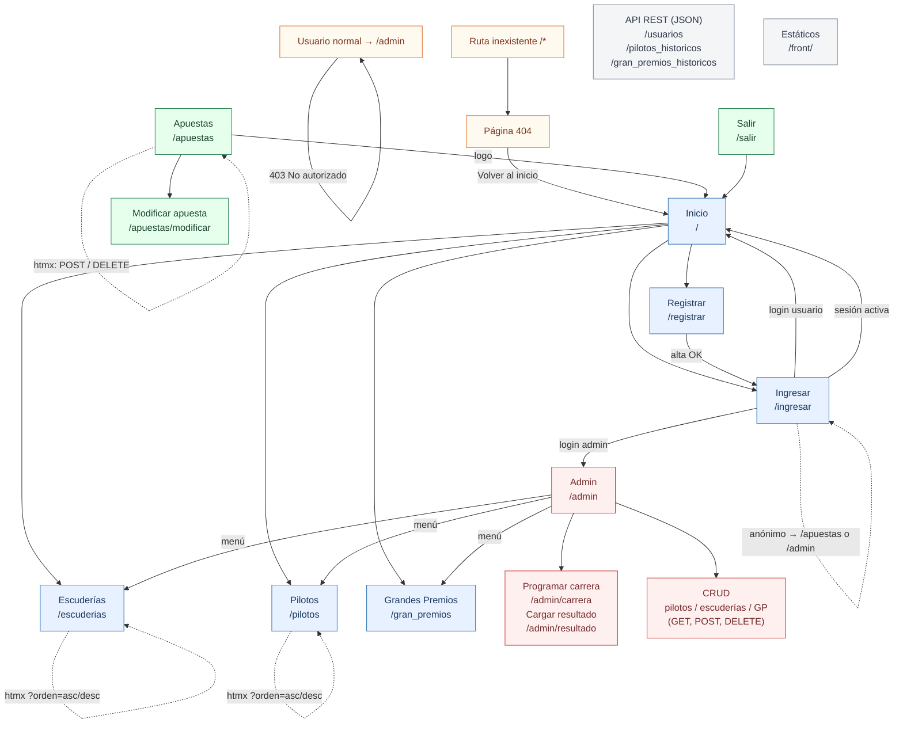

# Mapa de sitio y capturas — PredictOne

**Fecha:** 2026-11-19  
**Fuente:** recorrido real con Chrome headless sobre la API levantada con `make run`.

## Diagrama de navegación

## Leyenda de accesos

| Condición | Destino | Resultado observado |
|---|---|---|
| Visitante anónimo | `/apuestas`, `/admin` | Redirección a `/ingresar` |
| Login de usuario | `/` | Menú con “Apuestas” y “Cerrar sesión” |
| Login de admin | `/admin` | Menú de administración |
| Usuario normal | `/admin` | `403 No autorizado` (texto plano) |
| Sesión activa | `/ingresar` | Redirección a `/` |
| Cualquier ruta inexistente | Página 404 | Código HTTP 404 + link al inicio |

Los metadatos de cada captura (URL, título y altura) están en [`capturas/manifest.json`](capturas/manifest.json).

> Las capturas 10 y 13 evidencian dos hallazgos del [informe de navegación](INFORME_NAVEGACION.md): el 403 sin estilo y la pantalla de edición de Grandes Premios con el layout público en lugar del layout de administración.
