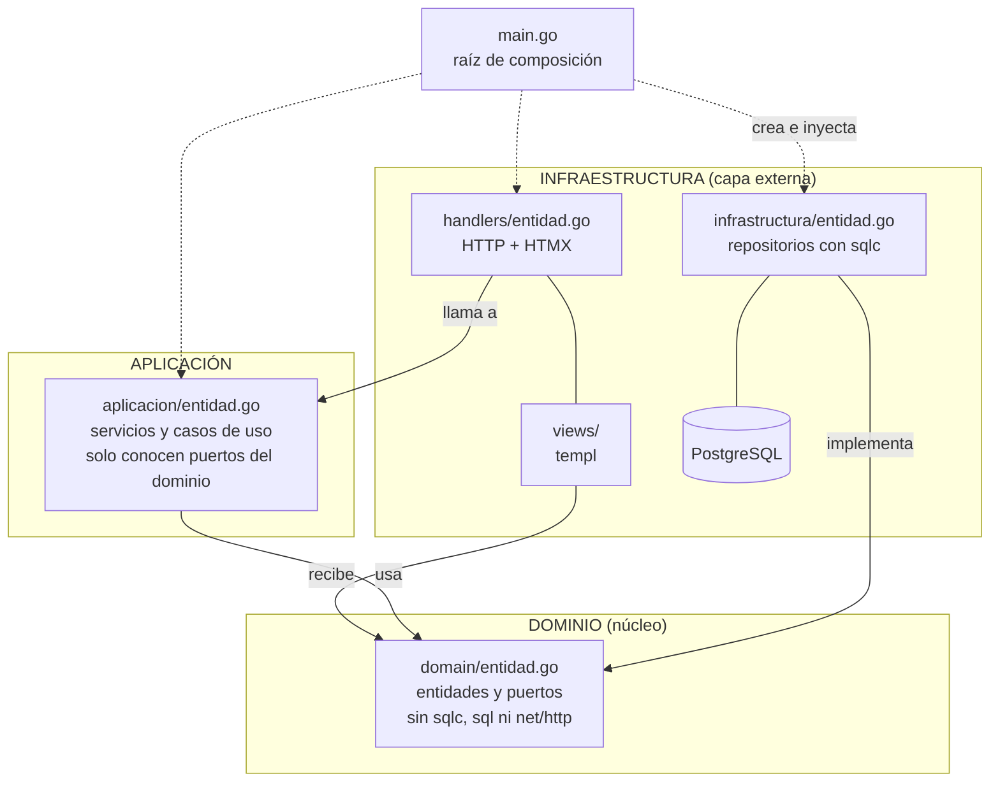
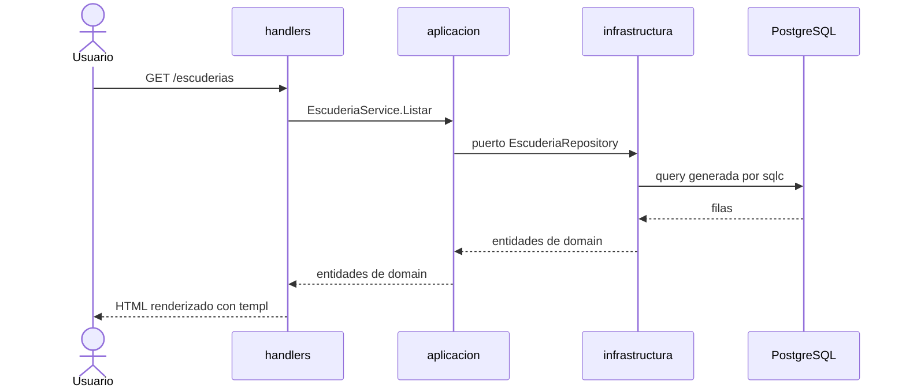
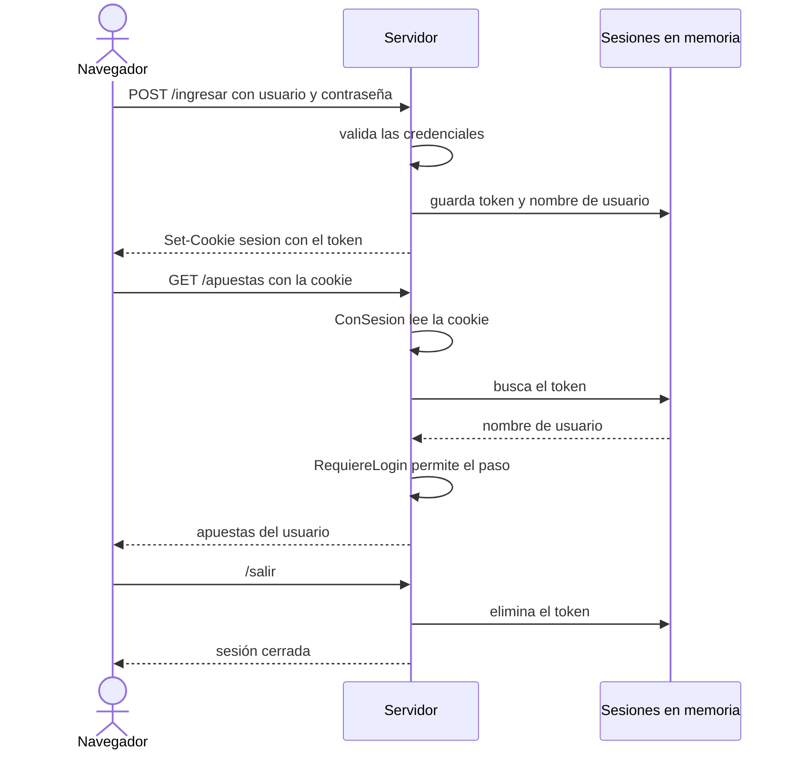
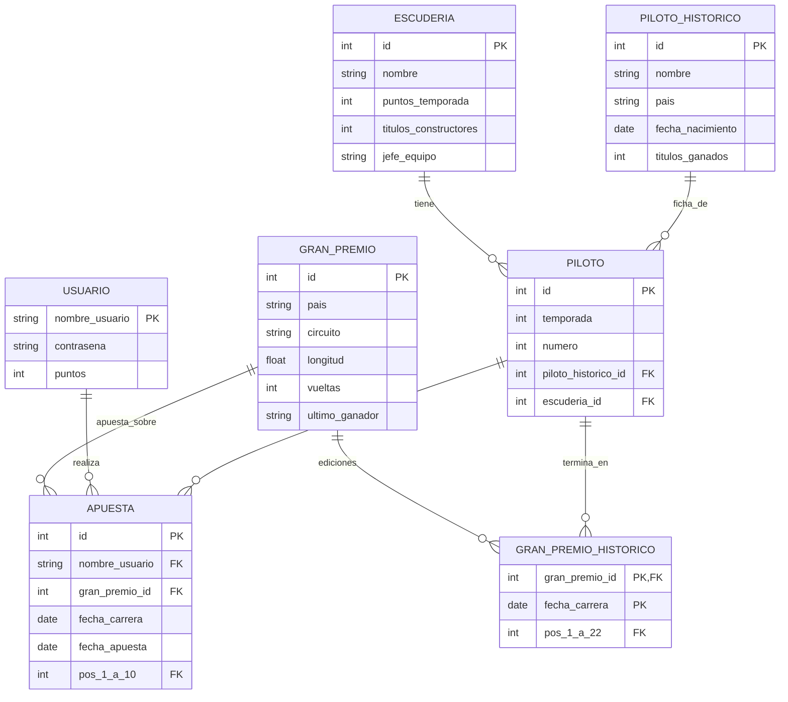

# PredictOne

**PredictOne** es una aplicación web para consultar información sobre la Fórmula 1 y realizar predicciones sobre los resultados de las carreras.

Permite:

* Registrarse, ingresar y salir del sitio.
* Consultar **escuderías**, **pilotos** y **Grandes Premios**.
* Cargar, modificar y eliminar **apuestas** (predicciones de los 10 primeros puestos de un Gran Premio), solo con la sesión iniciada.
* Con el usuario **Admin**: administrar pilotos, escuderías y Grandes Premios, programar carreras y cargar resultados desde un panel de administración.
* Consumir una **API REST** para usuarios, pilotos históricos y Grandes Premios históricos.

---

## Índice

1. [Tecnologías utilizadas](#tecnologías-utilizadas)
2. [Cómo ejecutar el proyecto](#cómo-ejecutar-el-proyecto)
3. [Arquitectura (Onion)](#arquitectura-onion)
4. [Endpoints](#endpoints)
5. [Sesiones y cookies](#sesiones-y-cookies)
6. [Modelo de datos](#modelo-de-datos)
7. [Error 404](#error-404)

---

## Tecnologías utilizadas

| Tecnología | Descripción |
| :--- | :--- |
| **Go** | Servidor HTTP (`net/http`) y lógica de negocio. |
| **templ** | Generación de las vistas HTML desde Go (paquete `views`). |
| **HTMX** | Altas, modificaciones y bajas sin recargar la página. |
| **PostgreSQL** | Base de datos relacional para el almacenamiento persistente. |
| **sqlc** | Generación de código Go seguro a partir de consultas SQL. |
| **Docker / Docker Compose** | Containerización de la API y de la base de datos. |
| **Make** | Automatización de compilación y ejecución. |

---

## Cómo ejecutar el proyecto

### Requisitos previos

Tener instalados: `git`, `make`, `go`, `sqlc`, `templ`, `docker` (con Docker Compose).

### 1. Clonar el repositorio

```bash
git clone https://github.com/gianfrancocanale/Proyecto_web.git
cd Proyecto_web
```

### 2. Cambiar al branch del tp6

```bash
git checkout tp6
```

### 3. Configurar las variables de entorno

Las credenciales de la base de datos se leen desde un archivo `.env`. El `Makefile` lo genera a partir de `.env.example` si no existe. Variables utilizadas:

| Variable | Descripción |
| :--- | :--- |
| `DB_HOST` | Host de la base de datos (`database` dentro de Docker). |
| `DB_PORT` | Puerto de PostgreSQL. |
| `DB_USER` | Usuario de la base. |
| `DB_PASSWORD` | Contraseña de la base. |
| `DB_NAME` | Nombre de la base. |

### 4. Ejecutar la aplicación

```bash
make run
```

Esto genera el código de `sqlc` y `templ`, compila el proyecto y levanta PostgreSQL y la API en Docker. Cuando termina, el sitio queda disponible en:

**http://localhost:8080**

Si querés ingresar como administrador: Usuario: admin - Contraseña: admin123

---

## Arquitectura (Onion)

El proyecto sigue una **arquitectura de cebolla (Onion Architecture)**: el código se organiza en capas concéntricas y **las dependencias apuntan siempre hacia adentro**. El dominio, en el centro, no conoce a ninguna otra capa.

### Esquema



### Estructura de carpetas

Para **cada entidad** hay un `.go` en cada capa. Las entidades son: `escuderia`, `usuario`, `piloto`, `piloto_historico`, `gran_premio`, `gran_premio_historico` y `apuesta`. Además existe el módulo de **administración** (`admin`), que no es una entidad sino un caso de uso que coordina varias.

```
Proyecto_web/
├── domain/               ← NÚCLEO: entidades y puertos (interfaces). Sin imports de sqlc, sql ni net/http
│   ├── escuderia.go
│   ├── usuario.go
│   ├── piloto.go
│   ├── piloto_historico.go
│   ├── gran_premio.go
│   ├── gran_premio_historico.go
│   └── apuesta.go
├── aplicacion/           ← APLICACIÓN: servicios y casos de uso, solo conocen el dominio
│   ├── escuderia.go
│   ├── usuario.go
│   ├── piloto.go
│   ├── piloto_historico.go
│   ├── gran_premio.go
│   ├── gran_premio_historico.go
│   ├── apuesta.go
│   └── admin.go
├── infrastructura/       ← INFRAESTRUCTURA: repositorios que implementan los puertos con sqlc
│   ├── escuderia.go
│   ├── usuario.go
│   ├── piloto.go
│   ├── piloto_historico.go
│   ├── gran_premio.go
│   ├── gran_premio_historico.go
│   └── apuesta.go
├── handlers/             ← INFRAESTRUCTURA: HTTP, sesiones y middlewares
│   ├── escuderia.go
│   ├── usuario.go
│   ├── piloto.go
│   ├── piloto_historico.go
│   ├── gran_premio.go
│   ├── gran_premio_historico.go
│   ├── apuesta.go
│   └── admin.go
├── views/                ← INFRAESTRUCTURA: vistas templ
├── front/                ← Archivos estáticos (CSS, imágenes), servidos bajo /front/
└── main.go               ← raíz de composición (único lugar que conoce todo)
```

### Responsabilidad de cada capa

| Capa | Carpeta | Qué contiene | Qué puede importar |
| :--- | :--- | :--- | :--- |
| **Dominio** | `domain/` | Entidades del negocio y **puertos** (interfaces de repositorio). | Nada del proyecto, ni `sqlc`, ni `database/sql`, ni `net/http`. |
| **Aplicación** | `aplicacion/` | **Servicios**: reglas de negocio y casos de uso. Trabajan contra los puertos del dominio. | Solo `domain`. |
| **Infraestructura (persistencia)** | `infrastructura/` | **Repositorios**: implementan los puertos con el código generado por `sqlc` y devuelven entidades del dominio. | `domain`, `sqlc`, `database/sql`. |
| **Infraestructura (entrada)** | `handlers/`, `views/` | Traducen HTTP a llamadas a servicios y renderizan las vistas `templ`. **No acceden a la base de datos.** | `aplicacion`, `domain`, `net/http`, `templ`. |
| **Raíz de composición** | `main.go` | Abre la conexión, crea los repositorios, los inyecta en los servicios, los servicios en los handlers y registra las rutas. | Todo. |

### Cableado de dependencias (`main.go`)

La inyección se hace en tres pasos: repositorios → servicios → handlers.

| Servicio | Repositorios que usa |
| :--- | :--- |
| `EscuderiaService` | escuderia |
| `UsuarioService` | usuario |
| `PilotoService` | piloto, escuderia |
| `PilotoHistoricoService` | piloto histórico |
| `GranPremioService` | gran premio, piloto histórico |
| `GranPremioHistoricoService` | gran premio histórico, gran premio, piloto histórico |
| `ApuestaService` | apuesta, gran premio histórico, piloto, piloto histórico |
| `AdminService` | usuario, gran premio, gran premio histórico, apuesta, piloto |

| Handler | Servicios que usa |
| :--- | :--- |
| `EscuderiaHandler` | escuderia, usuario |
| `UsuarioHandler` | usuario |
| `PilotoHandler` | piloto, usuario |
| `GranPremioHandler` | gran premio, piloto histórico, usuario |
| `ApuestaHandler` | apuesta, usuario, gran premio histórico, piloto |
| `AdminHandler` | admin |
| `PilotoHistoricoHandler` | piloto histórico |
| `GranPremioHistoricoHandler` | gran premio histórico |

### Flujo de una request



### Beneficios

* **Independencia de la base de datos:** cambiar `sqlc` o PostgreSQL solo afecta a `infrastructura/`.
* **Testeabilidad:** los servicios se prueban con repositorios falsos, sin base de datos ni HTTP.
* **Reglas de negocio aisladas:** viven en `aplicacion/` y `domain/`, sin mezclarse con HTTP ni SQL.
* **Regla de dependencia verificable:** si `domain/` o `aplicacion/` importan `sqlc`, `sql` o `net/http`, la arquitectura se rompió.

---

## Endpoints

Los métodos se indican tal como se registran en el `mux`. Cuando una ruta no declara método (`—`), el handler despacha internamente según el método HTTP.

**Niveles de acceso:** `Público` (sin sesión), `Sesión` (middleware `RequiereLogin`), `Admin` (middleware `RequiereAdmin`).

### Sitio público

| Método | Ruta | Acceso | Descripción |
| :---: | :--- | :---: | :--- |
| GET | `/front/` | Público | Archivos estáticos (CSS, imágenes). |
| GET | `/{$}` | Público | Página de inicio (solo la raíz exacta). |
| GET | `/escuderias` | Público | Listado de escuderías, con botón para invertir el orden. |
| GET | `/pilotos` | Público | Listado de pilotos. |
| GET | `/gran_premios` | Público | Listado de Grandes Premios y circuitos. |
| — | `/ingresar` | Público | Formulario de inicio de sesión (GET) y validación (POST). |
| — | `/registrar` | Público | Formulario de registro de usuario (GET) y alta (POST). |
| — | `/*` | Público | Cualquier otra ruta: página 404 con código de estado `404`. |

### Usuario con sesión

| Método | Ruta | Acceso | Descripción |
| :---: | :--- | :---: | :--- |
| — | `/salir` | Sesión | Cierra la sesión. |
| — | `/apuestas` | Sesión | Ver las apuestas propias y cargar una nueva eligiendo un Gran Premio y los 10 pilotos. |
| GET | `/apuestas/modificar` | Sesión | Formulario para modificar una apuesta. |
| POST | `/apuestas/modificar` | Sesión | Guarda la modificación de una apuesta. |
| DELETE | `/apuestas/{id}` | Sesión | Elimina una apuesta propia. |

### Administración (solo Admin)

| Método | Ruta | Acceso | Descripción |
| :---: | :--- | :---: | :--- |
| — | `/admin` | Admin | Panel de administración. |
| — | `/admin/carrera` | Admin | Programar una carrera. |
| — | `/admin/resultado` | Admin | Cargar el resultado de una carrera. |
| POST | `/pilotos` | Admin | Alta de piloto (formulario libre). |
| GET | `/pilotos/modificar` | Admin | Formulario para modificar un piloto. |
| POST | `/pilotos/modificar` | Admin | Guarda la modificación de un piloto. |
| DELETE | `/pilotos/{id}` | Admin | Elimina un piloto. |
| POST | `/escuderias` | Admin | Alta de escudería. |
| GET | `/escuderias/modificar` | Admin | Formulario para modificar una escudería. |
| POST | `/escuderias/modificar` | Admin | Guarda la modificación de una escudería. |
| DELETE | `/escuderias/{id}` | Admin | Elimina una escudería. |
| POST | `/gran_premios` | Admin | Alta de Gran Premio. |
| GET | `/gran_premios/modificar` | Admin | Formulario para modificar un Gran Premio. |
| POST | `/gran_premios/modificar` | Admin | Guarda la modificación de un Gran Premio. |
| DELETE | `/gran_premios/{id}` | Admin | Elimina un Gran Premio. |

### API REST

| Método | Ruta | Acceso | Descripción |
| :---: | :--- | :---: | :--- |
| GET | `/usuarios` | Público | Lista los usuarios. |
| POST | `/usuarios` | Público | Crea un usuario. |
| PUT | `/usuarios/{nombre}` | Público | Actualiza un usuario. |
| DELETE | `/usuarios/{nombre}` | Público | Elimina un usuario. |
| — | `/pilotos_historicos` | Público | Listar (GET) y crear (POST) pilotos históricos. |
| — | `/pilotos_historicos/{id}` | Público | Consultar (GET), actualizar (PUT) y eliminar (DELETE) un piloto histórico. |
| — | `/gran_premios_historicos` | Público | Listar (GET) y crear (POST) Grandes Premios históricos. |
| — | `/gran_premios_historicos/{id}/{fecha_carrera}` | Público | Consultar, actualizar y eliminar una edición histórica, identificada por Gran Premio y fecha de carrera. |


---

## Sesiones y cookies

La aplicación usa **cookies para mantener la sesión**, ya que HTTP no guarda estado entre requests.



1. **Ingreso:** con credenciales válidas, el servidor genera un **token**, lo asocia al nombre de usuario en un mapa **en memoria** y lo envía al navegador en la cookie `sesion`.
2. **Cada request:** el navegador devuelve la cookie automáticamente. El middleware **`ConSesion`** envuelve a todo el `mux`: busca el token y, si existe, deja el nombre de usuario en el contexto de la request. Las vistas lo usan, por ejemplo, para mostrar el usuario en la barra de navegación.
3. **Rutas con sesión:** **`RequiereLogin`** protege `/salir` y las rutas de apuestas. Si no hay sesión activa, redirige a `/ingresar`.
4. **Rutas de administración:** **`RequiereAdmin`** (del `AdminHandler`) protege `/admin` y las altas, modificaciones y bajas de pilotos, escuderías y Grandes Premios. Solo permite el paso al usuario **Admin**.
5. **Salida:** `/salir` elimina la sesión.

### Decisión de seguridad importante

**El usuario de cada apuesta se obtiene siempre de la cookie**, nunca de un campo del formulario ni de la URL. Así, nadie puede crear, modificar o eliminar apuestas a nombre de otro, aunque manipule la request.

> **Limitación conocida:** como las sesiones viven en memoria, **se pierden al reiniciar el servidor** y no se comparten entre instancias.

---

## Modelo de datos

### Diagrama entidad-relación



> **Nota:** los nombres exactos de columnas pueden diferir de `schema.sql`. `pos_1_a_10` y `pos_1_a_22` representan en el diagrama a las columnas de posiciones (`pos_1`, `pos_2`, …), cada una con clave foránea a `PILOTO`.

### Restricciones principales

| Restricción | Detalle |
| :--- | :--- |
| **Claves primarias** | `usuario.nombre_usuario`; `id` en el resto, salvo el histórico de Gran Premio (Gran Premio + fecha de carrera). |
| **Claves foráneas** | `piloto → escuderia`, `piloto → piloto_historico`, `gran_premio_historico → gran_premio`, `apuesta → usuario`, `apuesta → gran_premio`. |
| **Unicidad** | Una apuesta es única por **usuario + Gran Premio + fecha de carrera**. |
| **Integridad** | Una apuesta tiene 10 posiciones; un resultado histórico, 22. |

### Entidades y qué se puede hacer con cada una

| Entidad | Descripción | Qué se puede hacer |
| :--- | :--- | :--- |
| **Usuario** | Usuarios registrados. Clave primaria: `nombre_usuario`. Guarda los puntos ganados. | Registrarse, ingresar y salir. Vía API REST: listar, crear, actualizar y eliminar. |
| **Apuesta** | Predicción de un usuario para un Gran Premio y una fecha de carrera: 10 posiciones y fecha de apuesta. | Con sesión: **crear**, **ver**, **modificar** y **eliminar** las propias. |
| **Escudería** | Equipos: puntos de temporada, títulos de constructores y jefe de equipo. | **Consultar** el listado en orden ascendente o descendente. El **Admin** puede **crear**, **modificar** y **eliminar**. |
| **Piloto** | Pilotos actuales (por temporada), asociados a una escudería y a su ficha histórica. | **Consultar** el listado; se usan como opciones al apostar. El **Admin** puede **crear** (formulario libre: número, nombre, país, nacimiento, títulos, escudería), **modificar** y **eliminar**, con actualización inmediata vía HTMX. |
| **Piloto histórico** | Datos de pilotos: país, fecha de nacimiento y títulos ganados. | Vía API REST: listar, crear, consultar, actualizar y eliminar. |
| **Gran Premio** | País, circuito, longitud, cantidad de vueltas y último ganador. | **Consultar** el listado; es el evento sobre el que se apuesta. El **Admin** puede **crear**, **modificar** y **eliminar**. |
| **Gran Premio histórico** | Ediciones pasadas: fecha de carrera y resultado (22 posiciones). | Vía API REST: listar, crear, consultar, actualizar y eliminar. El **Admin** programa carreras y carga resultados desde `/admin`. |

---

## Error 404

Cualquier ruta que no coincida con ninguna de las anteriores muestra una página de error 404 (`NoEncontradoPage`). Responde con código de estado `404` y tiene un botón que redirige a la página de inicio (`/`).

Se registra con el patrón `"/"`, que Go aplica solo a las rutas que ninguna otra captura; la raíz exacta sigue siendo atendida por `"GET /{$}"`.
